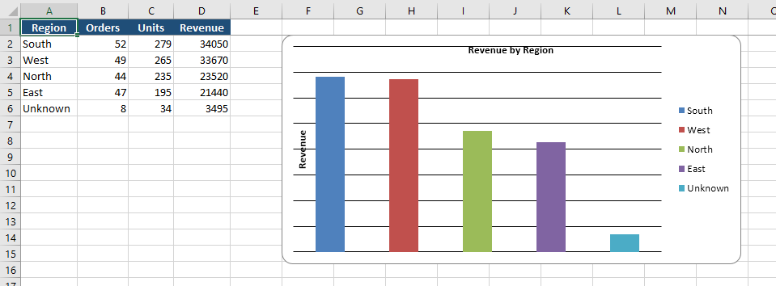
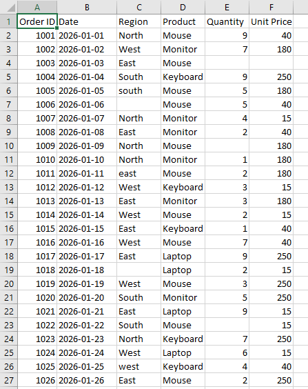
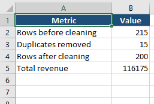

# Excel Report Automation with Python

Turn a messy Excel file into a clean, formatted, multi-sheet report with one command.

The script reads raw sales data, removes duplicates, fixes inconsistent text, fills missing values, builds summary tables, and saves a formatted Excel report with a chart.



## Before and after

**Before:** messy raw data with duplicates, blank cells and inconsistent text



**After:** a cleaning summary on the Overview sheet



## Features

- Removes duplicate rows
- Standardises text (for example, `"north "` becomes `"North"`)
- Fills missing values sensibly (median quantity, typical price per product)
- Adds calculated columns (Revenue, Month)
- Builds summary tables by region, by product, and by month
- Saves everything to one Excel file with styled headers, auto-sized columns, and a bar chart

## Output sheets

| Sheet | Contents |
|---|---|
| Overview | Rows before and after cleaning, duplicates removed, total revenue |
| By Region | Orders, units, and revenue per region, with a bar chart |
| By Product | Units and revenue per product |
| Monthly | Revenue per month, split by region |
| Clean Data | The full cleaned dataset |

## Requirements

- Python 3.9 or newer
- pandas
- openpyxl

## How to run

```bash
git clone https://github.com/zaima-20/excel-report-automation.git
cd excel-report-automation
pip install -r requirements.txt
python excel_report_automation.py
```

On the first run, the script creates a messy sample file (`raw_sales.xlsx`) so you can see it working right away. It then saves the finished report as `sales_report.xlsx`.

## Use it with your own data

Replace `raw_sales.xlsx` with your own file, then update the column names in `clean_data()` and `build_summaries()` to match your columns.

## Author

**Zaima Sohail** · [GitHub](https://github.com/zaima-20)
